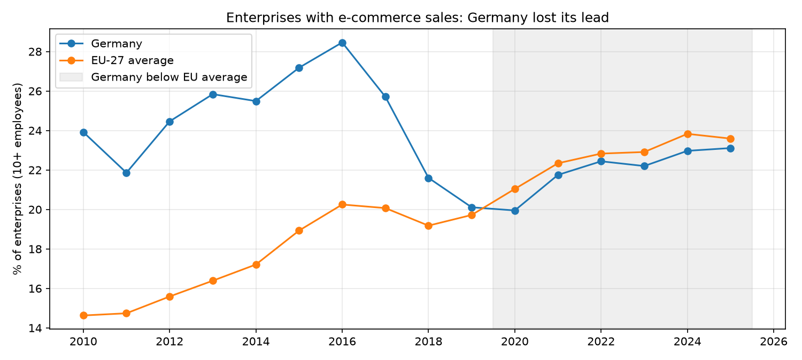
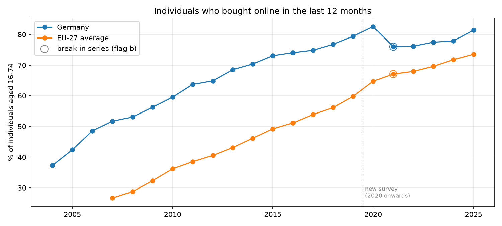
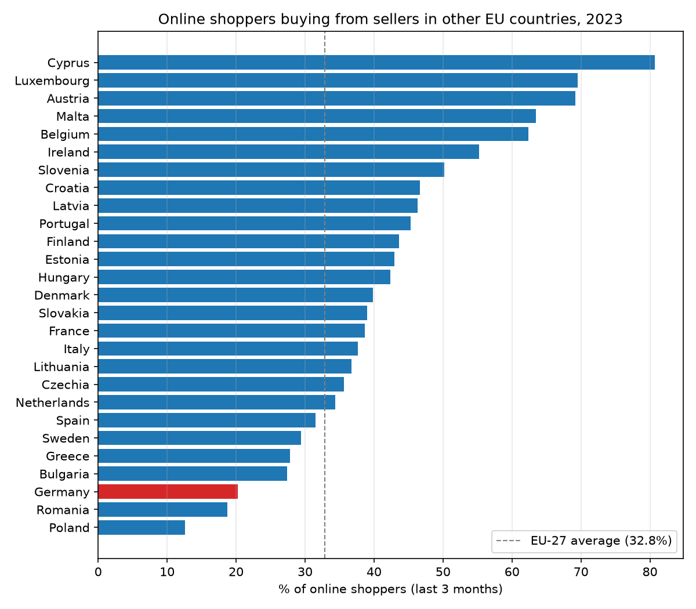

# EU and German E-commerce Market Analysis

How does Germany's e-commerce market compare with the rest of the EU? This project takes official Eurostat statistics for the 27 EU countries, builds a star schema in PostgreSQL, answers the question with SQL, and exports the same model for a Power BI report.

It covers both sides of the market: **businesses** that sell online, and **consumers** who buy online.

## Findings

Latest year with data, Germany against the EU-27 average:

| Indicator | Germany | EU-27 | Germany's rank (of countries with data) | Year |
|---|---|---|---|---|
| Individuals who bought online in the last 12 months | 81.4% | 73.6% | 7 of 27 | 2025 |
| Online shoppers buying from any foreign seller | 25.0% | 40.2% | 25 of 27 | 2023 |
| Online shoppers buying from sellers in other EU countries | 20.3% | 32.8% | 25 of 27 | 2023 |
| Online shoppers buying from sellers outside the EU | 11.6% | 20.1% | 25 of 27 | 2023 |
| Online shoppers buying from national sellers | 79.0% | 83.0% | 20 of 27 | 2023 |
| Enterprises with e-commerce sales | 23.1% | 23.6% | 17 of 27 | 2025 |
| E-commerce sales as a share of enterprise turnover | 19.1% | 19.5% | 12 of 27 | 2025 |
| Enterprises with web sales to other EU countries | 9.0% | 8.6% | 7 of 19 | 2025 |
| Enterprises with web sales to the rest of the world | 4.9% | 5.2% | 12 of 19 | 2025 |

Rank 1 is the highest value. Enterprise figures cover enterprises with 10 or more employees.

1. **German consumers are ahead of the EU.** 81% of Germans aged 16 to 74 bought something online in the last 12 months, against 74% across the EU.
2. **German shoppers rarely buy from abroad.** Only 25% of German online shoppers bought from a foreign seller, against 40% across the EU. Germany ranks 25th of 27. Country size probably plays a part, since a large market has more domestic sellers. But France, Italy and Spain are also large and still buy abroad more than Germany, so size alone doesn't explain it.
3. **German businesses lost their e-commerce lead.** In 2013, the share of German enterprises selling online was 9.5 percentage points above the EU average. Since 2020 it has been below the EU average every year, and in 2025 it was 0.5 points below. Germany's share is lower now than in 2010 (23.1% against 23.9%), while the EU average rose by 9 points.







### What this could mean for a business

These are implications to test, not conclusions the data proves:

- **For a foreign online retailer entering Germany:** demand is high, but German shoppers mostly buy from German sellers. A German-language shop, local delivery and local returns are likely to matter more than shipping cross-border.
- **For German businesses:** consumers are ahead of the EU, but businesses have fallen behind. That gap suggests room for German companies, and for e-commerce service providers who sell to them.

## Data

Eurostat, Digital economy and society statistics. Five datasets:

| Dataset | What it covers | Years used |
|---|---|---|
| `isoc_ec_esels` | Enterprises with e-commerce and web sales, by destination | 2010–2025 |
| `isoc_ec_evals` | Value of e-commerce sales, as a share of turnover | 2010–2025 |
| `isoc_ec_ibuy` | Individuals' online purchases (survey up to 2019) | 2004–2019 |
| `isoc_ec_ib20` | Individuals' online purchases (survey from 2020) | 2020–2025 |
| `isoc_ec_ibos` | Online purchases by seller origin | 2020–2023 |

**Citation:** Source: Eurostat, datasets `isoc_ec_esels`, `isoc_ec_evals`, `isoc_ec_ibuy`, `isoc_ec_ib20` and `isoc_ec_ibos`, https://ec.europa.eu/eurostat/databrowser/view/{dataset}/default/table, accessed 2 November 2026. The full list with links is in [`powerbi/sources.csv`](powerbi/sources.csv).

**Licence:** Creative Commons Attribution 4.0 (CC BY 4.0), under Eurostat's copyright notice.

**Changes made to the data:** nine indicators were selected from the five datasets (see `src/eu_ecom/series.py`). They were reshaped from one column per year to one row per value, limited to the 27 EU countries and the EU-27 average, and cells without a value were removed. The two individuals' surveys were joined into one indicator. Values and Eurostat flags are otherwise unchanged.

## How it works

```
Eurostat API (5 datasets, TSV)
  -> eurostat.py     parse each cell into a value and a flag, one row per value
  -> series.py       which dimension codes make up each of the 9 indicators
  -> build.py        select the indicators, build the star schema, load PostgreSQL, export CSVs
  -> sql/*.sql       four KPI queries
  -> kpis.py         run the queries, save results/*.csv
  -> plots.py        three charts
  -> powerbi/        the same star schema as CSVs, for the Power BI report
```

### Star schema

- `fact_observation`: one row per indicator, country and year, with the value, Eurostat flag and source dataset.
- `dim_country`: the 27 EU countries and the EU-27 average, with an `is_eu27` column.
- `dim_indicator`: the nine indicators, with label, side (business or consumer), unit and source datasets.

### KPI queries

| File | What it answers |
|---|---|
| `01_germany_vs_eu.sql` | Germany against the EU average for every indicator and year, with the gap and the flags |
| `02_germany_rank_latest.sql` | Germany's rank among EU countries in the latest year, and the top country |
| `03_change_since_first_year.sql` | Change from the first to the last year, marking periods that cross a break in series |
| `04_business_lead_lost.sql` | Germany's largest lead in business e-commerce, and the year it fell behind |

### Checks

- Germany's 2025 gap (−0.48 points), its rank (17th of 27), its largest lead (2013, 9.45 points) and the first year behind (2020) were recomputed independently in pandas from the exported CSVs, and matched the SQL.
- The build stops with an error if any indicator, country and year appears twice.
- 9 tests cover cell parsing, flag handling, joining the two surveys, and the dimension tables.

## Power BI

The star schema is exported to `powerbi/` as CSVs. [`docs/powerbi_guide.md`](docs/powerbi_guide.md) explains how to build the report: the relationships, the DAX measures (Germany, EU-27 average, gap, rank), and five pages. Power BI Desktop runs only on Windows, and the report file is not in the repo yet.

## Limits

- **Breaks in the series.** Eurostat changed its household survey in 2020, and flags many 2021 values with "b". Changes across that point mix real movement with a change in method. Query 03 marks these periods, and the consumer charts show them.
- **Unexplained business drop.** Germany's share of enterprises selling online fell from 28.5% in 2016 to 20.1% in 2019. Eurostat doesn't flag a break there, and I haven't investigated the cause.
- **Shares, not money.** The indicators are percentages of enterprises, turnover or people. They don't show market size in euros.
- **Larger enterprises only.** Enterprise figures cover firms with 10 or more employees, so micro-businesses aren't included.
- **Multiple answers.** Shoppers can buy from several seller origins, so the origin shares don't add up to 100%.
- **Gaps in coverage.** The cross-border web sales indicators have data for 19 countries, and the seller-origin data ends in 2023.
- **Implications are not tested.** The business implications above are hypotheses suggested by the data, not results.

## Reproduce

```bash
conda create -n euecom python=3.11 -y
conda activate euecom
pip install -r requirements.txt
createdb eu_ecommerce

PYTHONPATH=src python -m eu_ecom.build    # downloads from Eurostat, loads PostgreSQL, writes powerbi/*.csv
PYTHONPATH=src python -m eu_ecom.kpis     # runs the SQL, writes results/*.csv
PYTHONPATH=src python -m eu_ecom.plots    # draws the charts
pytest
```

Eurostat updates these datasets, so a new download can change the latest values.

## Project structure

```
src/eu_ecom/
  series.py      the nine indicators and their Eurostat codes
  eurostat.py    download and parse Eurostat TSV files
  build.py       star schema, PostgreSQL load, Power BI export
  kpis.py        runs the SQL queries
  plots.py       charts
sql/             schema and the four KPI queries
powerbi/         star schema CSVs and sources, for Power BI
results/         KPI results and charts
docs/            Power BI build guide
tests/           pytest suite
```
